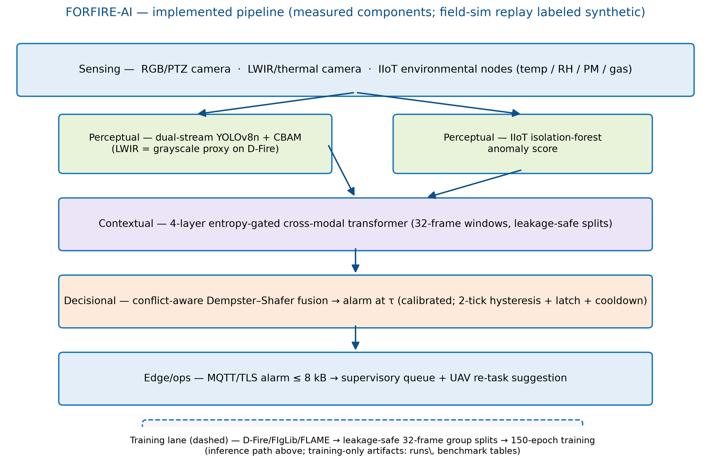
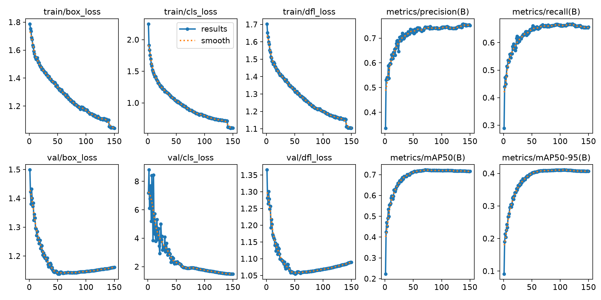
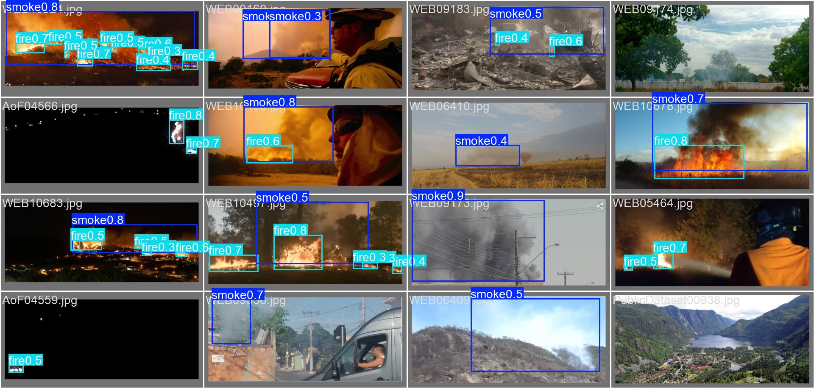
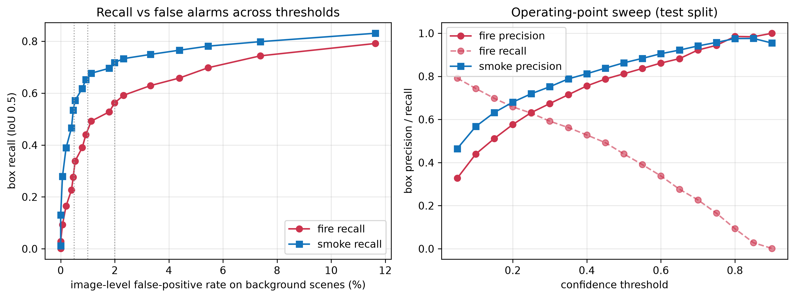
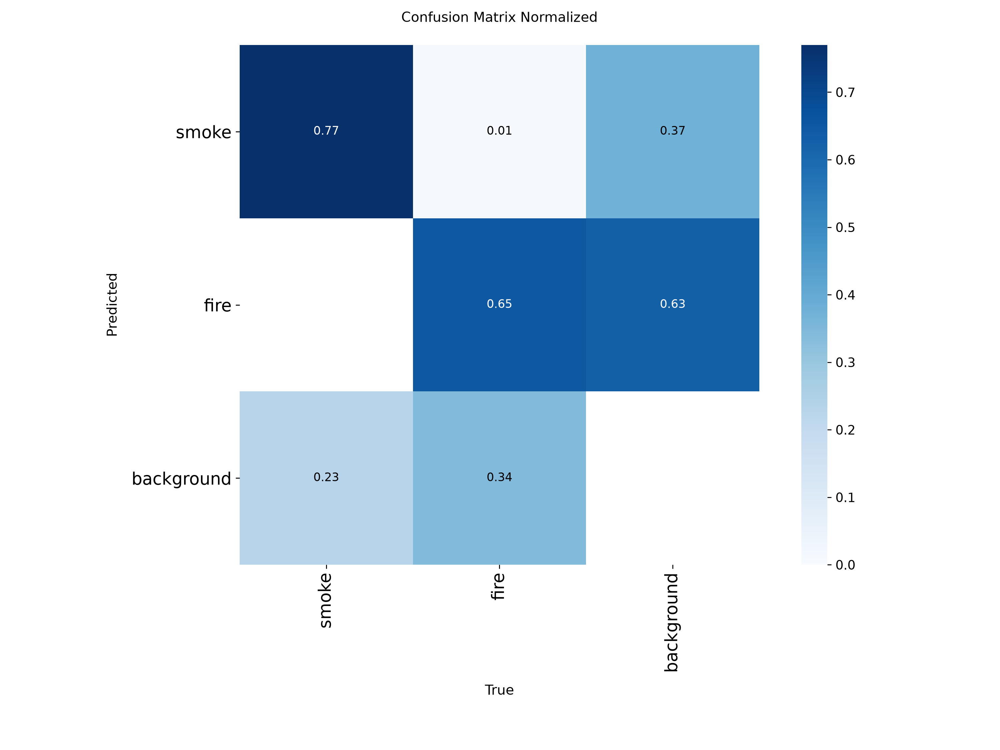
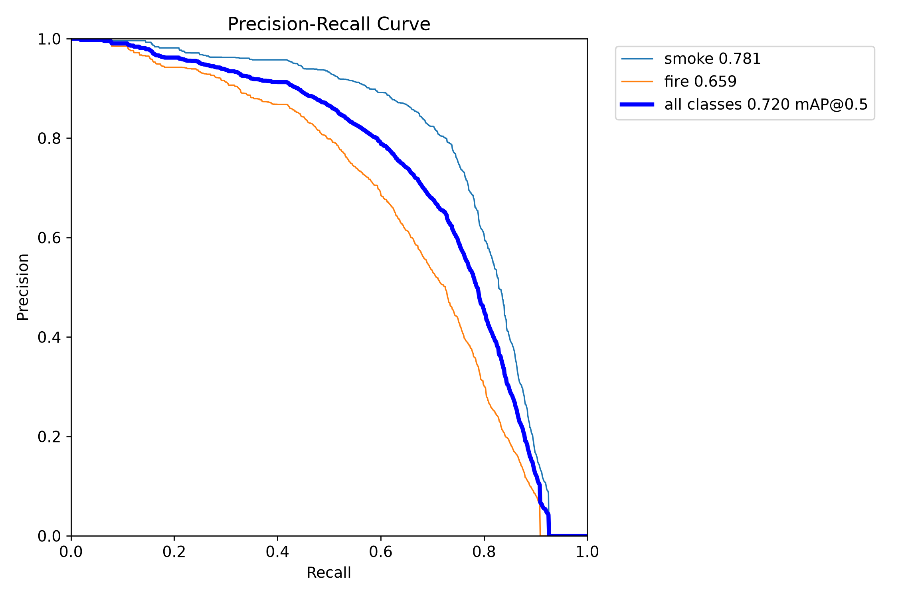

# wildfire-fusion — Multimodal Wildfire Early-Warning System

Three-tier, four-layer fire detection per the build spec:

```
Sensing        PTZ RGB+LWIR camera · on-demand UAV RGB · IIoT env. nodes (temp/RH/PM/gas)
Perceptual     dual-stream YOLOv8n + CBAM (RGB & LWIR) · IIoT isolation-forest score
Contextual     4-layer entropy-gated cross-modal transformer -> refined confidences
Decisional     conflict-aware Dempster–Shafer fusion -> alarm at fire-mass threshold
Edge/ops       ONNX -> TensorRT INT8 (Jetson) · MQTT/TLS · supervisory alarm loop
```

Benchmarks: **FLAME** (aerial RGB+LWIR), **D-Fire** (ground RGB), **FIgLib** (fixed-view PTZ).

> **Interactive explainer:** open [`docs/index.html`](docs/index.html) in any browser —
> a single self-contained page (works offline via double-click) with a clickable
> architecture diagram, a step-through of Algorithm 1, a **live Dempster–Shafer fusion
> playground** (same math as `src/decisional/evidential_fusion.py`), and an entropy-gate
> heatmap for eq. (3). To serve it instead: `python -m http.server 8123 --directory docs`.

> **Live platform (live video feed + the trained model):** `run_Platform.bat` — or
> `python scripts\run_platform.py` — starts a local web app that runs the real
> dual-stream detector on a live video feed and shows the fused decision live.
> The sensing layer is source-agnostic: a local capture device, an IP/**RTSP**
> network camera (**PTZ** included), a video file, or a YouTube URL all attach
> without touching the pipeline.
> See [§7](#7-live-platform--run-the-trained-model-on-a-live-video-feed).

---

## Results at a glance

| | |
|:---:|:---:|
| **Architecture — three tiers, four layers** | **Training curves** |
|  |  |
| **Test-split detections (D-Fire)** | **Operating-point analysis** |
|  |  |
| **Confusion matrix (normalized, test)** | **Precision–recall** |
|  |  |

Full-size figures, the false-positive gallery, per-class metrics and the LaTeX results
table are in [`postdo/`](postdo/); result CSVs (Tables IV/V/VI, ablation, field-sim
timeline) and raw latency traces are in [`results/`](results/).

---

## 0. Run everything from the repo root

All commands below assume you are at the repo root:

```bat
cd wildfire-fusion
python --version                  :: 3.11 verified
```

Optional venv (the code also runs against the system Python):

```bat
python -m venv .venv
.venv\Scripts\activate            :: Linux/macOS: source .venv/bin/activate
pip install -r requirements.txt
```

---

## 1. Path A — full demo, NO datasets needed (5 minutes)

This exercises every tier end-to-end. All outputs are labeled **SYNTHETIC**.

```bat
:: 1. Unit tests — the leakage-control assertion runs here too (spec §3.5 / §12)
pytest -v
::    expect: 49 passed

:: 2. Dual-stream model smoke test (builds yolov8n offline, forward + loss + backward + NMS)
python scripts\smoke_dual_stream.py
::    add --pretrained to also verify the yolov8n.pt weight transfer (~6 MB download)

:: 3. Synthetic field-trial replay: Algorithm 1 over a full timeline, alarm -> MQTT + queue
python scripts\run_field_sim.py --events 3 --config plus_iiot
::    outputs: results\field_sim\timeline_plus_iiot.csv + summary_plus_iiot.json
::    expect: alarm_rate 1.0, detection_horizon_mean_s around -55 (IIoT leads but saturates late)
::    other configs: ptz_only | plus_lwir | iiot_only

:: 4. Contextual tier training (toy windows, ~30 s on CPU)
python src\train_contextual.py --synthetic
::    outputs: runs\contextual_synthetic_<ts>\{best.pt, train_config.yaml, history.json}
::    expect: val accuracy -> 1.0 on the separable toy task

:: 5. Decisional calibration: grid-search r_c, r_d, r_s and tau (spec §6)
python src\calibrate_decisional.py --synthetic
::    writes: configs\decisional_calibration.yaml  (the fusion loop auto-loads this file)
::    DELETE this file to fall back to the defaults in configs\default.yaml

:: 6. Ablations (Table VI) with bootstrap CIs on each delta
python benchmark\ablation.py --events 3
::    writes: results\ablation.csv

:: 7. Table V: all four fusion configurations (PTZ-only, +LWIR, +IIoT, IIoT-only)
python benchmark\run_benchmark.py --table v --events 3
::    writes: results\table_v.csv
::    expect: plus_lwir and plus_iiot alarm; ptz_only and iiot_only stay under tau (correct DS behavior)
```

Then re-run the field sim with the calibrated file to see the loop load it:

```bat
python scripts\run_field_sim.py --events 3 --config plus_iiot --calibration configs\decisional_calibration.yaml
```

Useful extras:

```bat
python scripts\run_field_sim.py --checkpoint runs\contextual_synthetic_<ts>\best.pt   :: real transformer instead of identity refinement
python src\edge\trt_quantize.py --data-root data --n 5000                             :: calibration image list (TensorRT engine itself builds on the Jetson only)
```

---

## 2. Path B — real data, end-to-end (D-Fire first: no auth wall)

### 2.1 Get the data

```bat
python scripts\get_datasets.py --dataset dfire
::    git-clones gaiasd/DFireDataset into data\dfire_raw, reorganizes into
::    data\dfire\{images,labels}\{train,val,test}, writes data\dfire\.done

python scripts\get_datasets.py --dataset figlib --subset 5    :: smoke test before the full HPWREN pull
python scripts\get_datasets.py --dataset flame                :: prints IEEE DataPort manual steps (free account + license)
```

Auth walls: FLAME needs an IEEE DataPort login (no anonymous bulk endpoint — the script
prints the steps, and honors `IEEE_DATAPORT_COOKIE` / kagglehub mirrors). FIgLib's
official split manifest may be non-JSON — the script saves it to
`data\figlib\splits_raw.txt` for inspection.

### 2.2 Leakage-safe splits + label harmonization

```bat
python scripts\build_splits.py --dataset dfire
::    writes: data\dfire\split_manifest.csv (frame_path,event_id,split,label)
::            data\dfire\{train,val,test}.txt
::            data\dfire\dataset.yaml (ultralytics config)

python scripts\harmonize_labels.py --dataset dfire
::    writes: data\dfire\labels_harm\  (canonical [smoke, fire] ids)
::    FAILS LOUDLY if a class id is outside the mapping — verify, don't trust the table
```

### 2.3 Train the perceptual tier (§4)

```bat
:: Main model — single-stream RGB (Ultralytics trainer, uses configs\default.yaml)
python src\train_perceptual.py --dataset dfire --arch single --mode rgb
::    outputs: runs\single_rgb_dfire_<ts>\weights\best.pt (+ train_config.yaml)

:: Full system — dual-stream RGB+LWIR with CBAM and the eq.(2) weighted loss
::    Short CPU smoke run first:
python src\train_perceptual.py --dataset dfire --arch dual --epochs 2
::    Real run (GPU strongly recommended):
python src\train_perceptual.py --dataset dfire --arch dual
::    outputs: runs\dual_dfire_<ts>\{best.pt, last.pt, train_config.yaml}
::    LWIR comes from data\dfire\lwir\ paired frames if present, else a grayscale proxy
::    (documented placeholder — use FLAME2 registered RGB/IR pairs for a real two-modal run)

:: Paper baselines under IDENTICAL splits/augmentation (§12 parity requirement)
python src\train_perceptual.py --dataset dfire --arch baseline --model yolov5su
python src\train_perceptual.py --dataset dfire --arch baseline --model yolov8n
::    yolov7-tiny is not in Ultralytics — train it from the WongKinYiu repo using the
::    same data\dfire\{train,val,test}.txt lists
```

### 2.4 Benchmark (Table IV) — mAP@.5, image-level P/R/F1, bootstrap CIs, confusion matrices

```bat
python benchmark\run_benchmark.py --table iv --dataset dfire ^
    --weights runs\single_rgb_dfire_<ts>\weights\best.pt ^
    --weights runs\dual_dfire_<ts>\best.pt ^
    --weights runs\baseline_yolov5su_<ts>\weights\best.pt
::    writes: results\table_iv.csv + latency_raw_<model>.json (raw traces, per checklist)
```

### 2.5 Contextual tier on real embeddings + final calibration

```bat
:: 1. Export per-frame embeddings + max-detection confidence from the trained perceptual model
python -c "import sys; sys.path.insert(0,'.'); from src.train_contextual import extract_embeddings; extract_embeddings(r'runs\dual_dfire_<ts>\best.pt', [l.strip() for l in open(r'data\dfire\train.txt')], 'runs\emb\dfire_frames.npz')"

:: 2. Group frames into 32-frame windows per event (leakage-safe, from the manifest)
python -c "import sys; sys.path.insert(0,'.'); from src.train_contextual import build_windows; build_windows(r'data\dfire\split_manifest.csv', r'runs\emb\dfire_frames.npz', 'runs\emb\windows.npz')"

:: 3. Train the entropy-gated transformer (AdamW 5e-4, 30 ep, early stopping)
python src\train_contextual.py --embeddings runs\emb\windows.npz

:: 4. Recalibrate r_m and tau on YOUR validation ticks (never ship the synthetic one)
python src\calibrate_decisional.py --ticks-csv results\field_sim\labeled_ticks.csv --target-recall 0.9
```

### 2.6 Edge export (§7)

```bat
python src\edge\export_onnx.py --perceptual-weights runs\dual_dfire_<ts>\best.pt --out runs\export
python src\edge\export_onnx.py --contextual-checkpoint runs\contextual_real_<ts>\best.pt --out runs\export
::    TensorRT INT8: copy the .onnx files to the Jetson, then
python src\edge\trt_quantize.py          :: prints the exact trtexec command + builds the 5,000-image calib list
```

---

## 3. Layout

```
configs/            default.yaml (all ASSUMPTION-labeled defaults), datasets.yaml
data/               gitignored; filled by scripts\get_datasets.py
scripts/            get_datasets, build_splits, harmonize_labels, run_field_sim, smoke_dual_stream
src/perceptual/     cbam · dual_stream_yolo · losses (eq. 2) · iiot_branch
src/contextual/     positional · gated_transformer (eq. 3)
src/decisional/     evidential_fusion (eq. 4–5)
src/edge/           export_onnx · trt_quantize · mqtt_client
src/pipeline/       fusion_loop — Algorithm 1 + operational policies
src/platform/       live platform — camera · engine · pipeline · server + static UI
src/                train_perceptual · train_contextual · calibrate_decisional
benchmark/          metrics · run_benchmark (Tables IV/V) · ablation (Table VI)
tests/              93 tests: leakage assertion, DS fusion math, gates, IIoT, loop policies,
                    payload budget, and the live platform (preprocessing parity, refiner,
                    frame sources, upload, HTTP layer)
results/            committed result artifacts: Tables IV/V/VI CSVs, ablation CSV,
                    field-sim timeline + summary, raw latency traces
postdo/             committed figures & paper assets: architecture, training curves,
                    confusion matrices, PR/F1 curves, FP gallery, LaTeX results table
```

---

## 4. What is NOT shipped (and how to get it)

- **The three databases (≈9.6 GB) are not in this repo.** They live under `data/`,
  are re-fetchable with `python scripts/get_datasets.py --dataset dfire|figlib|flame`,
  and are fully documented in [DATASETS.md](DATASETS.md) (sources, sizes, splits,
  per-step usage).
- **Trained weights are not committed** (`runs/` and `*.pt` are gitignored). Retrain
  with §2.3, or run `python scripts/smoke_dual_stream.py --pretrained` to pull the
  stock `yolov8n.pt` backbone (~6 MB, auto-downloaded from Ultralytics).
- Everything needed to *verify results without retraining* is committed: the result
  CSVs/JSON traces in [`results/`](results/) and all figures/tables in
  [`postdo/`](postdo/).

---

## 4. Data notes

- **FLAME** — IEEE DataPort (free account, license acceptance); no anonymous bulk
  endpoint. FLAME2 has 53,451 registered RGB/IR pairs — prefer it for co-registered
  dual-stream training.
- **D-Fire** — `git clone` of `gaiasd/DFireDataset`, reorganized into
  `data/dfire/{images,labels}/{train,val,test}`. Class ids `{0: smoke, 1: fire}` are an
  ASSUMPTION — `harmonize_labels.py` verifies against the actual label files.
- **FIgLib** — official CV splits (already sequence-level; keeps leakage out). The
  gitlab-snippet manifest format is not fixed; `get_datasets.py` saves what it fetches
  to `data/figlib/splits_raw.txt` for inspection when it can't auto-parse.

---

## 5. Assumption register (spec-mandated, swap for real values)

| Where | Assumption |
|---|---|
| `configs/default.yaml:perceptual_training` | AdamW, lr 1e-3, cosine, 150 ep, batch 16, light smoke-tuned augs (mosaic 0.5) |
| `configs/default.yaml:contextual` | d_model 256, 8 heads, 4 layers, dropout 0.1 (paper gives only 4 layers) |
| `src/perceptual/dual_stream_yolo.py` | fusion = channel-concat + 1×1 conv after stage-2 C2f (paper doesn't give fusion depth) |
| `src/perceptual/losses.py` | eq. (2) mapped onto Ultralytics TAL: CIoU+DFL←λ1, BCE/focal←λ2, +explicit obj BCE←λ3 |
| `src/perceptual/iiot_branch.py` | 60 s sampling, ±30 s alignment window, z-score norm, outage = no ffill across gaps ≥ 5 min |
| `src/decisional/evidential_fusion.py` | divergence = Jousselme distance; threshold 0.3; τ 0.78 (theirs); reliability fallbacks 0.8/0.8/0.6 |
| `src/train_contextual.py` | contextual training objective = window-level BCE (paper gap) |
| `configs/default.yaml:operational` | 2 s clock skew, 2 missed beats → inactive, 2-tick hysteresis, 300 s cooldown |
| dual-stream LWIR on RGB-only datasets | grayscale proxy (placeholder — use FLAME2 pairs) |

Every one of these is also flagged inline in code/config with `ASSUMPTION`.

## 6. Limitations carried over from the paper (do not oversell)

- Detection horizon is reported over N=3 events (86 s ± 14 s in the paper) — expect high
  variance; `run_benchmark.py --table v` reports bootstrap CIs.
- FPR/24h uses an explicitly logged denominator (`false alarms / no-fire windows`).
- Baseline parity (same splits/augs) is only true if YOU train the baselines here.
- The pre-reproduction gates live in [REPRODUCIBILITY.md](REPRODUCIBILITY.md).

---

## 7. Live platform — run the trained model on a live video feed

A local web app that runs the **actual trained pipeline** on a live video feed:
dual-stream YOLOv8n+CBAM detects, the entropy-gated transformer refines the
confidence, Dempster–Shafer fusion decides, and the browser shows the annotated
video next to the live fusion telemetry.

The sensing layer is source-agnostic — anything OpenCV/FFmpeg can open attaches
without modifying the pipeline: a **local capture device** (built-in or USB), an
**IP/RTSP network camera, including PTZ units**, a recorded video file, a
YouTube URL, or a synthetic test pattern for a machine with no camera at all.

```bat
:: the one-liner (Windows)
run_Platform.bat

:: or directly
python scripts\run_platform.py --list-cameras     :: find your camera device index
python scripts\run_platform.py --camera 0         :: run on device 0
```

Then open **http://127.0.0.1:8080**.

### What runs where

| Layer | Component | Source |
|---|---|---|
| Sensing | OpenCV capture (local device / IP-RTSP / PTZ / video file / YouTube / synthetic) | `src/platform/camera.py` |
| Perceptual | dual-stream YOLOv8n+CBAM, or a single-stream checkpoint | `src/platform/engine.py` |
| Contextual | trained entropy-gated transformer over a rolling 32-frame window | `src/platform/pipeline.py` |
| Decisional | conflict-aware DS fusion, τ, hysteresis, MQTT publish | `src/pipeline/fusion_loop.py` (unmodified) |
| Edge/ops | annotated MJPEG stream + JSON telemetry + control endpoints | `src/platform/server.py` |

Checkpoints are picked automatically — the newest `runs/dual_*/best.pt` (falls back
to `runs/single_*/weights/best.pt`) and the newest `runs/contextual_*/best.pt`.
Override with `--weights` / `--contextual`; `--no-contextual` falls back to identity
refinement (same convention as `scripts/run_field_sim.py`).

### Input sources — camera, MP4, or YouTube

The **Input source** panel in the UI switches the input at runtime. The model, the
fusion loop and the server keep running; only the frame source is swapped.

| Source | How |
|---|---|
| **Local camera device** | pick the device index (auto-detected) and press *Use this camera* |
| **RTSP / IP / PTZ camera** | paste the stream URL (`rtsp://host:554/stream`, ONVIF/PTZ units included) in the video-path box — any stream OpenCV/FFmpeg can open |
| **Video file** | pick an MP4 from the dropdown, or type an absolute path, or drag a file onto the live view |
| **YouTube** | paste a URL — yt-dlp resolves it and the clip is streamed straight into OpenCV |
| **Test pattern** | an animated synthetic plume, for a machine with no camera |

Uploaded videos and videos downloaded from YouTube land in `media/` and show up in
the dropdown.

```bat
python scripts\run_platform.py --source file --path C:\videos\fire.mp4
python scripts\run_platform.py --source youtube --youtube "https://youtu.be/XXXX"
python scripts\run_platform.py --media-dir media           :: where files are kept
```

**How YouTube is handled.** Only the video track is requested (`bestvideo`) — a
detector needs no audio, and YouTube serves audio and video as separate DASH
streams, so this yields a plain mp4 that FFmpeg reads over HTTPS. If that URL
cannot be decoded it is downloaded into `media/` and played from disk instead.
The direct URL is time-limited, so the source re-resolves it when the stream ends.
`yt-dlp` needs a JavaScript runtime for some videos; if extraction fails the error
is shown in the UI instead of failing silently.

### Useful switches

```bat
python scripts\run_platform.py --source synthetic          :: no camera needed (test pattern)
python scripts\run_platform.py --source file --path clip.mp4
python scripts\run_platform.py --source youtube --youtube "https://youtu.be/XXXX"
python scripts\run_platform.py --camera 1 --fps 15          :: second device, faster loop
python scripts\run_platform.py --camera2 2                  :: fuse a second RGB camera
python scripts\run_platform.py --iiot                       :: add a SIMULATED IIoT modality
python scripts\run_platform.py --tau 0.60 --conf 0.35       :: sensitivity
python scripts\run_platform.py --policy weighted            :: Table VI ablation, live
python scripts\run_platform.py --mqtt-host 192.168.1.10     :: publish alarms over MQTT
```

### Read the telemetry correctly

- **The LWIR half is a proxy.** A plain RGB camera has no thermal sensor, so the dual-stream
  model's LWIR channels are filled with the grayscale proxy of the RGB frame — the same
  documented placeholder the training path uses on RGB-only datasets. The thermal
  modality carries no independent information here.
- **One camera caps the fused mass.** With a single modality `m(F) = r·π̂ ≤ r`, and
  `r_c = 0.80` by default, so **τ must be below 0.80** for the alarm to be reachable
  at all. That is the DS framework behaving correctly, not a bug — the UI says so too.
- **τ = 0.78 is the paper's number**, calibrated on the authors' validation set.
  Recalibrate on your own data (`src/calibrate_decisional.py`) before treating an
  alarm as a detection claim.
- The `--iiot` modality is **SIMULATED** (an independent synthetic walk, labelled as
  such in the UI). The paper's IIoT branch is an isolation forest fitted on ≥12 months
  of history, which does not ship with this repo.

### HTTP API

| Endpoint | Purpose |
|---|---|
| `GET /` | the UI |
| `GET /video.mjpg` | annotated live stream (`multipart/x-mixed-replace`) |
| `GET /api/status` | JSON telemetry — fused mass, per-modality π, divergence, FPS |
| `GET /api/media` | camera devices, video files in `media/`, YouTube availability |
| `POST /api/upload` | multipart upload of a video file into `media/` |
| `POST /api/control` | `{"action":"set_tau","value":0.6}` · `set_conf` · `set_policy` · `set_source` · `rescan_cameras` · `start` · `stop` · `clear_alarm` |

Platform tests: `pytest tests/test_platform.py -v` — preprocessing parity with the
training path, the windowed refiner, the FusionLoop policy switch, the frame
sources (camera/file/YouTube/synthetic + the source manager), the multipart upload
and the HTTP layer.

